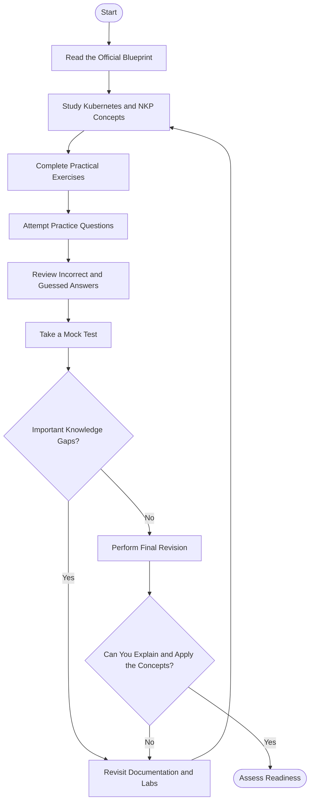
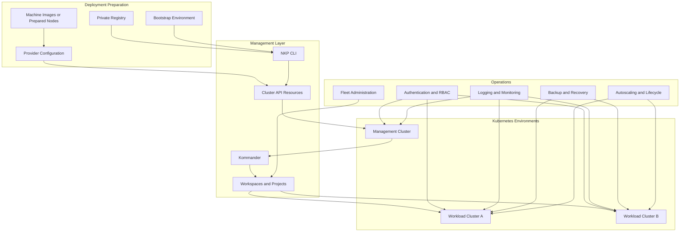
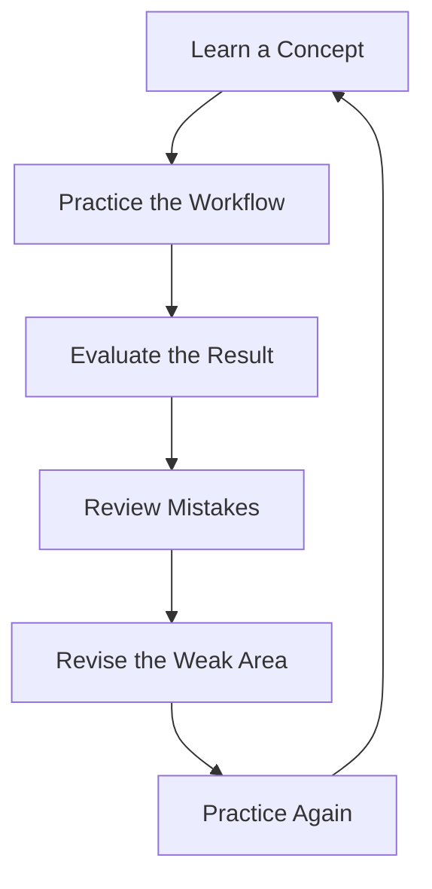
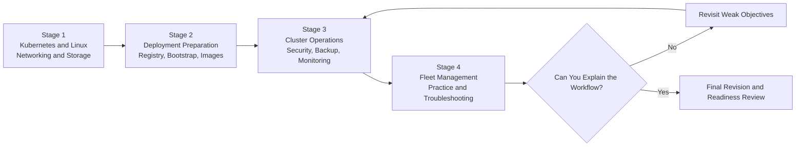
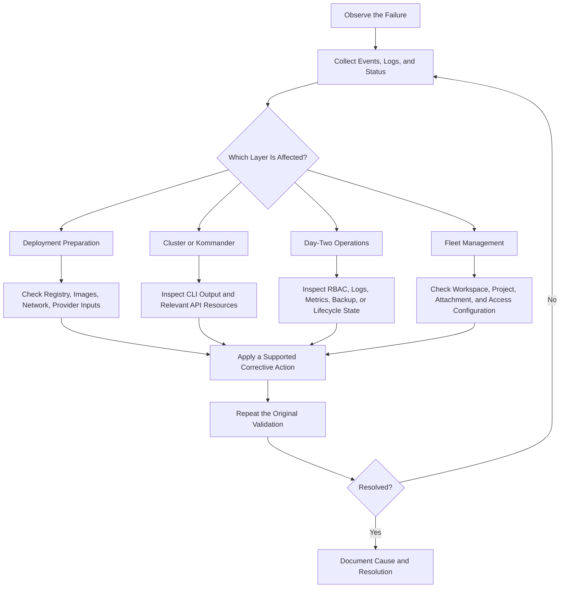

# Nutanix Certified Professional – Cloud Native (NCP-CN) 6.10 Study Guide

A practical, community-focused study guide for the **Nutanix Certified Professional – Cloud Native (NCP-CN) 6.10** certification. This repository helps candidates organize their preparation around Nutanix Kubernetes Platform (NKP), cluster deployment, Kubernetes administration, security, monitoring, backup and recovery, lifecycle management, and fleet operations.

The goal is to connect exam objectives with the technical decisions administrators make when building and managing cloud-native environments.

> **Recommended approach:** Read the official blueprint, understand the infrastructure, practice deployment and administration workflows, troubleshoot realistic scenarios, and use practice questions to identify knowledge gaps.

This repository is an independent educational resource. Nutanix's official certification page and exam blueprint remain the primary references for current requirements.

- **Official certification:** [Nutanix Certified Professional – Cloud Native](https://www.nutanix.com/en_sg/support-services/training-certification/certifications/certification-details-nutanix-certified-professional-cloud-native-v6-10)
- **Supplementary preparation:** [CertsGate NCP-CN resources](https://certsgate.com/exams/nutanix/ncp-cn)

---

## Table of Contents

- [About NCP-CN](#about-ncp-cn)
- [Who Should Prepare?](#who-should-prepare)
- [Exam Details](#exam-details)
- [Official Exam Objectives](#official-exam-objectives)
- [Conceptual Skills Map](#conceptual-skills-map)
- [Certification Preparation Flowchart](#certification-preparation-flowchart)
- [NKP Architecture Overview](#nkp-architecture-overview)
- [Circular Study and Revision Cycle](#circular-study-and-revision-cycle)
- [Step-by-Step Preparation Guide](#step-by-step-preparation-guide)
- [Suggested Study Roadmap](#suggested-study-roadmap)
- [Practice Questions and Mock Tests](#practice-questions-and-mock-tests)
- [Hands-On Labs and Projects](#hands-on-labs-and-projects)
- [Troubleshooting Decision Tree](#troubleshooting-decision-tree)
- [Common Preparation Mistakes](#common-preparation-mistakes)
- [Career Relevance](#career-relevance)
- [Readiness Checklist](#readiness-checklist)
- [Frequently Asked Questions](#frequently-asked-questions)
- [Official and Supplementary Resources](#official-and-supplementary-resources)
- [About CertsGate](#about-certsgate)

---

## About NCP-CN

The **Nutanix Certified Professional – Cloud Native (NCP-CN)** certification evaluates the ability to deploy, configure, optimize, troubleshoot, and administer a Nutanix Kubernetes Platform cluster.

Unlike a study plan focused only on Kubernetes commands, NCP-CN preparation should cover the complete platform lifecycle. Candidates need to understand deployment prerequisites, cluster customization, platform services, operational security, backup and recovery, monitoring, scaling, upgrades, and centralized management of multiple clusters.

This repository focuses on the **NCP-CN 6.10** blueprint. Its technical subjects include Nutanix Kubernetes Platform (NKP), Cluster API concepts, Kommander, and cloud-native operational workflows.

### What this study guide covers

- Preparing an environment for NKP deployment.
- Private registry seeding and air-gapped environments.
- Bootstrap clusters, licensing, bastion hosts, and machine images.
- Infrastructure-provider configuration and cluster deployment.
- Cluster API resources and custom manifests.
- Kommander deployment and configuration.
- Authentication, authorization, and role-based access control.
- Logging, monitoring, backup, and recovery.
- Cluster autoscaling and lifecycle management.
- Workspaces, projects, attached clusters, and platform applications.

## Who Should Prepare?

Nutanix describes NCP-CN candidates as professionals with practical experience building and managing Kubernetes clusters and working with Linux and cloud-native platforms.

The official guidance identifies approximately **6–12 months of Kubernetes cluster experience, 6–12 months of Linux experience, and six months of Kubernetes-platform experience** as a typical background. Candidates are also expected to have networking and cloud-native fundamentals, with knowledge comparable to the Certified Kubernetes Administrator (CKA) level.

This certification may be particularly relevant to:

- DevOps engineers.
- Cloud and platform engineers.
- Kubernetes administrators.
- Site reliability engineers (SREs).
- Systems engineers.
- Solution architects and developers who manage cloud-native infrastructure.

If Kubernetes fundamentals are unfamiliar, start with pods, deployments, services, namespaces, persistent storage, networking, RBAC, and cluster troubleshooting before moving into NKP-specific administration.

## Exam Details

The official NCP-CN 6.10 exam blueprint publishes the following information.

| Item | Published details |
|---|---|
| Certification | Nutanix Certified Professional – Cloud Native |
| Exam version | NCP-CN 6.10 |
| Certification provider | Nutanix |
| Question count | 75 |
| Question types | Multiple-choice and multiple-response |
| Time limit | 120 minutes |
| Languages | English and Japanese |
| Price listed in the blueprint | US$200 per attempt |
| Published passing score | 3000 on a scaled score range of 1000–6000 |
| Related training | Nutanix Kubernetes Platform Administration (NKPA) |
| Software versions identified in the blueprint | NKP 2.12, AOS 6.10, Prism Central pc2024.2 |

These details refer to the 6.10 exam documentation, not necessarily every newer or beta exam offering. Nutanix has also announced an NCP-CN 7.5 beta, so confirm the version you intend to take before following version-specific preparation materials.

Check the [official NCP-CN certification page](https://www.nutanix.com/en_sg/support-services/training-certification/certifications/certification-details-nutanix-certified-professional-cloud-native-v6-10) and the [NCP-CN 6.10 Exam Blueprint Guide (PDF)](https://www.nutanix.com/content/dam/nutanix/en/resources/datasheets/ds-ebg-ncp-cn-6-10.pdf) for current exam information.

## Official Exam Objectives

The official NCP-CN 6.10 blueprint groups the tested knowledge into four sections. The summaries below are study-oriented explanations of those sections, not a replacement for the detailed objective list.

### 1. Prepare the Environment for an NKP Deployment

Study the prerequisites and decisions required before deploying a cluster.

Key topics include:

- Seeding a private registry and understanding air-gapped installation requirements.
- Creating a bootstrap cluster.
- Differentiating NKP license tiers and their features.
- Preparing a bastion host and understanding its network requirements.
- Building machine images with the relevant image-building tools or preparing nodes.
- Identifying target-provider networking, connectivity, storage, and operating-system requirements.

**Preparation goal:** Given a deployment scenario, explain which prerequisites must be satisfied and how you would investigate a failure before cluster creation.

### 2. Manage Building an NKP Cluster

This section focuses on deploying clusters and configuring Kommander.

Study how to:

- Use the NKP CLI to create and deploy clusters.
- Interpret cluster deployment parameters.
- Apply Cluster API concepts to cluster customization.
- Identify the relevant resources when a deployment fails.
- Determine when custom manifests are appropriate.
- Deploy and configure Kommander.
- Apply appropriate licenses and investigate Kommander deployment issues.

**Preparation goal:** Explain how deployment inputs, infrastructure resources, manifests, and platform dependencies fit together.

### 3. Perform Day 2 Operations

Day-two operations begin after deployment and continue throughout the cluster's lifecycle.

Focus on:

- Configuring identity providers, authentication, and authorization.
- Understanding Kommander roles, Kubernetes roles, role bindings, and role inheritance.
- Configuring logging applications and gathering logs.
- Managing logging in multitenant environments.
- Configuring cluster backup and recovery, including relevant Velero workflows.
- Understanding storage requirements and snapshot classes.
- Enabling monitoring, reviewing metrics, and configuring alerts.
- Investigating health and performance problems.
- Configuring cluster autoscaling.
- Managing upgrades, node pools, manual scaling, and cluster deletion.

**Preparation goal:** Demonstrate that you can operate an existing environment securely, observe its health, recover from problems, and manage changes.

### 4. Conduct NKP Fleet Management

Fleet management focuses on managing clusters and shared platform resources through centralized management workflows.

Study how to:

- Create and configure workspaces.
- Assign workload clusters to workspaces.
- Configure infrastructure providers and workspace-level access.
- Deploy workload clusters.
- Attach existing clusters and understand their supported capabilities.
- Update, detach, or delete clusters.
- Configure projects and project-level access control.
- Deploy platform applications at the appropriate scope.
- Troubleshoot workspace and cluster-management issues.

**Preparation goal:** Understand the difference between preparing an individual cluster and managing multiple clusters through a centralized platform.

### Exam domain weightings

The public exam blueprint identifies the four objective sections, but this README does not assign percentages to them. Use the current official blueprint if you need an authoritative domain-weighting chart.

## Conceptual Skills Map

The following diagram is an independent study overview, **not an official exam-weighting chart**.

```mermaid
flowchart TD
    A["NCP-CN 6.10 Skills"] --> B["Deployment Preparation"]
    A --> C["Cluster Deployment"]
    A --> D["Day-Two Operations"]
    A --> E["Fleet Management"]

    B --> B1["Private Registry and Air Gap"]
    B --> B2["Bootstrap and Licensing"]
    B --> B3["Bastion and Machine Images"]
    B --> B4["Provider Requirements"]

    C --> C1["NKP CLI"]
    C --> C2["Cluster API"]
    C --> C3["Custom Manifests"]
    C --> C4["Kommander"]

    D --> D1["Authentication and RBAC"]
    D --> D2["Logging and Monitoring"]
    D --> D3["Backup and Recovery"]
    D --> D4["Autoscaling and Upgrades"]

    E --> E1["Workspaces and Projects"]
    E --> E2["Workload Clusters"]
    E --> E3["Attached Clusters"]
    E --> E4["Platform Applications"]
```

Use this map to identify gaps in your knowledge. For example, troubleshooting a failed cluster deployment may require understanding provider configuration, image preparation, network connectivity, and Cluster API resources together.

## Certification Preparation Flowchart

Use a repeatable process instead of jumping directly into mock exams.

The decision point matters. A good score is useful evidence, but readiness also means being able to explain why a deployment option is appropriate, identify relevant resources, and describe how you would diagnose a failure.

## NKP Architecture Overview

The diagram below is a **conceptual learning model**, not an official reference architecture or complete deployment design. Actual components and deployment steps depend on the NKP version and supported infrastructure provider.

### Understanding the main components

- **Deployment preparation:** Registry access, bootstrap resources, images, connectivity, and provider settings must be ready for the intended installation.
- **NKP CLI:** Provides command-line workflows for supported deployment and administration tasks.
- **Cluster API:** Supplies Kubernetes APIs and resources used in cluster lifecycle management and customization.
- **Kommander:** Provides platform-management capabilities used by NKP workflows.
- **Workspaces and projects:** Organize and manage clusters, applications, and access at the relevant scope.
- **Operational services:** Logging, monitoring, backup, recovery, security, scaling, and upgrades support ongoing administration.

The most important skill is understanding the relationships between these components. If a deployment fails, identify the affected layer and inspect the relevant resources instead of repeatedly changing configuration without evidence.

## Circular Study and Revision Cycle

Cloud-native administration involves connected concepts, so preparation should be iterative.

For example, after studying Cluster API customization, practice explaining which resources you would inspect if a cluster deployment failed. If you cannot identify the relevant resources or interpret their state, return to the documentation and try a different scenario.

## Step-by-Step Preparation Guide

### Step 1: Start with the official blueprint

Download the [NCP-CN 6.10 Exam Blueprint Guide](https://www.nutanix.com/content/dam/nutanix/en/resources/datasheets/ds-ebg-ncp-cn-6-10.pdf).

Create a checklist for all four sections. Mark each objective as:

- **Unfamiliar:** You need to learn the concept.
- **Understood:** You can explain it, but have limited practical experience.
- **Practiced:** You can explain the concept and work through a relevant scenario.

Use the detailed objective descriptions and their associated documentation references to direct your study.

### Step 2: Strengthen Kubernetes and Linux fundamentals

Review:

- Kubernetes architecture and core resources.
- Namespaces, pods, deployments, services, and persistent storage.
- RBAC, roles, role bindings, and service accounts.
- Cluster networking and DNS.
- Linux command-line troubleshooting.
- Resource requests, limits, node capacity, and scheduling.
- Logs, events, and basic health diagnostics.

These foundations help you understand NKP workflows without treating every platform-specific command as something to memorize.

### Step 3: Learn deployment preparation

Study the purpose of registry seeding, bootstrap clusters, bastion hosts, machine images, and provider configuration.

Pay attention to air-gapped environments. Understand why image availability, connectivity, and registry configuration matter when an environment cannot pull artifacts directly from public repositories.

Build a deployment-readiness checklist that records prerequisites, dependencies, and validation steps.

### Step 4: Understand cluster deployment and Kommander

Learn the NKP CLI workflow and the role of Cluster API resources in customization. Study how manifests influence configuration and how deployment failures can be diagnosed by inspecting the relevant resources.

Then review Kommander deployment, platform applications, and licensing. Practice explaining which component you would investigate when a cluster deployment succeeds but a platform service does not become available.

### Step 5: Practice day-two operations

Study authentication, authorization, logging, backup, recovery, monitoring, autoscaling, and upgrades.

For each topic, answer three questions:

1. What problem does this capability solve?
2. Which configuration, resource, or dependency is relevant?
3. How would you validate that the operation succeeded?

For backup and recovery, for example, understand the storage prerequisites, backup configuration, and restore workflow rather than assuming that creating a backup automatically proves recoverability.

### Step 6: Study fleet management

Review the purpose and scope of workspaces and projects. Understand how workload clusters are deployed, how existing clusters are attached, and what happens when a cluster is detached or deleted.

Practice reasoning about access control at the correct scope. A user who can manage a workspace does not necessarily have every permission within every Kubernetes workload cluster.

### Step 7: Test, review, and repeat

Attempt practice questions after studying the related objectives. Record incorrect answers, uncertain answers, and concepts that you cannot explain clearly.

Use a supplementary resource such as [CertsGate NCP-CN preparation materials](https://certsgate.com/exams/nutanix/ncp-cn) for additional knowledge checks. Compare explanations with official documentation and revisit the source material when something is unclear.

## Suggested Study Roadmap

This is an independent four-stage roadmap, not an official Nutanix timetable. Adjust the pace to your existing experience and access to a practice environment.

| Stage | Focus | Practical outcome |
|---|---|---|
| 1. Foundations | Kubernetes, Linux, networking, storage, RBAC | Explain core cluster behavior and troubleshoot basic issues |
| 2. Deployment | Registry, bootstrap, licensing, bastion, images, provider settings | Describe deployment prerequisites and configuration decisions |
| 3. Operations | Kommander, security, logging, backup, monitoring, scaling, upgrades | Explain routine administration and common failure scenarios |
| 4. Fleet and review | Workspaces, projects, cluster attachment, practice tests | Reason through fleet-management decisions and close weak areas |

Move forward when you can explain the current stage, not merely when you have finished reading it.

## Practice Questions and Mock Tests

NCP-CN practice questions are most useful when they help you understand platform behavior and choose an appropriate response to a scenario.

### A six-step review method

For every question, use the following process:

1. **Answer:** Select an option and state the reason for your choice.
2. **Review:** Read the explanation and verify relevant details in official documentation.
3. **Understand:** Identify the underlying concept or dependency.
4. **Map the mistake:** Connect it to one of the four official objective sections.
5. **Revisit:** Study the relevant documentation or repeat the lab.
6. **Try again:** Use a different question or scenario to test whether the knowledge gap is resolved.

A correct answer based on guessing deserves review too. Memorizing the wording of a question does not demonstrate that you can apply the concept in a different environment.

### Map practice results to objectives

| Objective section | Useful self-check |
|---|---|
| Deployment preparation | Can I explain registry, bootstrap, licensing, image, and provider requirements? |
| Cluster deployment | Can I reason about NKP CLI parameters, Cluster API resources, and Kommander deployment? |
| Day-two operations | Can I explain RBAC, logging, backup, monitoring, autoscaling, and lifecycle operations? |
| Fleet management | Can I distinguish workspaces, projects, workload clusters, and attached clusters? |

### How to use mock tests

Take a mock test after covering the relevant material. Review the questions you missed and those you answered with uncertainty.

Do not treat a practice score as a guarantee of exam success. Use it to decide which concepts need further reading, hands-on work, or another round of scenario-based practice.

Third-party practice material should be used as supplementary learning, not represented as actual, leaked, or guaranteed exam questions.

## Hands-On Labs and Projects

Practical exercises can help connect the NCP-CN blueprint with real administration tasks. Use an authorized NKP environment, suitable test infrastructure, or documented examples. Do not assume every feature is available under every license or deployment model.

### Project 1: Deployment-readiness worksheet

Create a checklist covering:

- Registry requirements and air-gapped considerations.
- Bootstrap environment prerequisites.
- License tier and intended cluster use case.
- Bastion host and network requirements.
- Machine-image or node-preparation steps.
- Target-provider networking, connectivity, and storage.
- Post-deployment validation.

**Deliverable:** A deployment worksheet explaining each requirement and how you would verify it.

### Project 2: Cluster deployment investigation

In a suitable environment, study a documented cluster deployment workflow.

- Identify the required CLI inputs.
- Review the relevant Cluster API resources.
- Document how custom manifests affect the deployment.
- Record the expected state after a successful operation.
- Create a troubleshooting checklist for a failed deployment.

**Deliverable:** A deployment workflow and a diagnostic checklist. Do not run commands against production systems without appropriate authorization and change controls.

### Project 3: Access-control review

Create a small conceptual example showing how identity-provider configuration, roles, role bindings, and access scope fit together.

Document which permissions are required for a given administrative task and how you would verify that access is neither too broad nor too restrictive.

**Deliverable:** An access-control matrix and a short explanation of the relevant authorization layers.

### Project 4: Backup and recovery plan

Create a recovery plan that covers:

- Backup prerequisites and target storage.
- Relevant backup and volume-snapshot configuration.
- Backup scheduling and validation.
- Restore prerequisites and workflow.
- Verification after restoration.
- Troubleshooting steps when a backup or restore fails.

**Deliverable:** A recovery runbook that distinguishes a completed backup operation from a validated restore.

### Project 5: Fleet-management model

Design a conceptual environment with multiple workload clusters.

Show how workspaces, projects, cluster assignments, access controls, and platform applications are organized. Include an example of attaching an existing cluster and another example of safely planning a cluster decommissioning.

**Deliverable:** A fleet diagram and a decision checklist for cluster placement and lifecycle operations.

## Troubleshooting Decision Tree

A structured troubleshooting approach helps avoid unnecessary changes.

### Example troubleshooting matrix

| Symptom | Possible areas to investigate | Validation approach |
|---|---|---|
| Cluster deployment fails | Registry access, image availability, provider settings, networking, Cluster API resources | Review command output and the status of relevant resources |
| Kommander does not deploy successfully | Deployment parameters, platform resources, configuration, licensing | Inspect the documented deployment state and error details |
| A user cannot perform an administrative action | Identity provider, group mapping, roles, role bindings, authorization scope | Compare the required permission with the assigned role and verify access |
| Backup or restore fails | Storage requirements, snapshot classes, configuration, dependencies | Review the relevant logs and validate each prerequisite |
| Monitoring data is missing | Monitoring configuration, application status, data source, backend storage | Verify that monitoring is enabled and data is being collected |
| Autoscaling does not behave as expected | Scaling configuration, resource availability, provider support, workload conditions | Compare the intended scaling policy with observed cluster behavior |
| A cluster cannot be attached or removed | Connectivity, prerequisites, access, cluster state, management configuration | Check the documented attachment or deletion requirements before retrying |

These are diagnostic starting points, not guaranteed root causes. Gather evidence before making changes, alter one relevant variable at a time, and confirm the result.

## Common Preparation Mistakes

### Studying only Kubernetes fundamentals

Kubernetes knowledge is essential, but NCP-CN also covers NKP-specific deployment, Kommander, workspaces, projects, and fleet management. Allocate study time to all four objective sections.

### Memorizing CLI commands without understanding the resources

A command can fail for reasons that are not obvious from its syntax. Learn which resources and prerequisites are involved and how their status helps you diagnose the problem.

### Ignoring air-gapped deployment

Private registry seeding and offline installation requirements are explicit topics in the 6.10 blueprint. Understand the purpose of the workflow and the dependencies it addresses.

### Confusing authentication with authorization

Authentication establishes identity; authorization determines permitted actions. Study identity providers, role assignments, role bindings, and access scope as related but distinct concepts.

### Treating backup as proof of recoverability

A backup that has been created is not the same as a successfully validated restore. Understand the dependencies, restore workflow, and post-recovery verification.

### Overlooking fleet management

Workspaces, projects, workload clusters, and attached clusters have different purposes. Learn how the management model affects deployment, access, and application placement.

### Taking mock tests without reviewing mistakes

Repeated attempts are of limited value if you do not investigate why an answer was wrong. Map mistakes to objectives and revisit the relevant documentation.

## Career Relevance

NCP-CN preparation develops knowledge relevant to cloud-native infrastructure and Kubernetes platform operations.

The covered skills can support responsibilities in DevOps, platform engineering, cloud infrastructure, site reliability engineering, technical support, and solution architecture. Understanding deployment dependencies, access control, monitoring, recovery, and fleet administration can also help professionals work more effectively with managed Kubernetes environments.

The certification is one way to demonstrate structured knowledge. Practical troubleshooting ability, sound security decisions, and experience operating production systems remain important alongside certification.

## Readiness Checklist

Use this checklist before scheduling the exam. Mark an item only when you can explain the concept or work through a relevant scenario.

- [ ] I have reviewed the current official NCP-CN blueprint for the version I intend to take.
- [ ] I understand Kubernetes and Linux fundamentals at the expected level.
- [ ] I can explain private registry seeding and air-gapped deployment considerations.
- [ ] I understand bootstrap clusters, licensing, bastion hosts, machine images, and provider requirements.
- [ ] I can explain how NKP CLI inputs and Cluster API resources relate to cluster deployment.
- [ ] I understand Kommander deployment and configuration.
- [ ] I can distinguish authentication, authorization, roles, and role bindings.
- [ ] I understand logging and monitoring configuration and basic diagnostics.
- [ ] I can explain backup and recovery dependencies and validation.
- [ ] I understand cluster autoscaling, upgrades, node pools, and lifecycle operations.
- [ ] I can explain the roles of workspaces, projects, workload clusters, and attached clusters.
- [ ] I have reviewed incorrect and uncertain practice-question answers.
- [ ] I can explain why a selected answer is correct and why plausible alternatives do not fit.
- [ ] I have verified current exam details with Nutanix.

If multiple items remain unchecked, focus on the related objectives before relying on another mock-test score.

## Frequently Asked Questions

### What is the NCP-CN certification?

The Nutanix Certified Professional – Cloud Native certification measures skills in deploying, configuring, optimizing, troubleshooting, and administering a Nutanix Kubernetes Platform cluster.

### What are the main NCP-CN 6.10 exam objectives?

The official blueprint contains four sections: preparing an environment for NKP deployment, building an NKP cluster, performing day-two operations, and conducting NKP fleet management.

### How many questions are in NCP-CN 6.10?

The 6.10 blueprint lists 75 multiple-choice and multiple-response questions and a 120-minute time limit. Verify the details for your selected exam version before registration.

### Is Kubernetes experience important?

Yes. Nutanix recommends practical Kubernetes cluster and Linux experience, along with knowledge of cloud-native concepts. The official candidate profile describes knowledge comparable to the CKA level.

### Which training course is recommended?

Nutanix lists **Nutanix Kubernetes Platform Administration (NKPA)** as the related course. Check the [official training page](https://www.nutanix.com/en_gb/support-services/training-certification/training) for current availability and course details.

### Should I study the 6.10 or 7.5 material?

First verify which exam version you will take. This repository focuses on the NCP-CN 6.10 blueprint. Nutanix has announced a 7.5 beta, so do not assume that the versions have identical objectives or software requirements.

### Are third-party practice questions enough?

No single third-party resource should replace the official blueprint, product documentation, and practical study. Practice questions are useful for identifying weak areas and checking understanding, but they do not guarantee an exam result.

### Is this an official Nutanix study guide?

No. This repository is an independent learning resource. Nutanix's official certification page and blueprint are authoritative for exam requirements and objectives.

## Official and Supplementary Resources

Use official provider documentation as the foundation of your preparation. Supplement it with practical labs, community discussions, and additional knowledge checks.

### Official Nutanix resources

- [NCP-CN Certification Page](https://www.nutanix.com/en_sg/support-services/training-certification/certifications/certification-details-nutanix-certified-professional-cloud-native-v6-10) — exam overview, candidate background, objectives, and published details.
- [NCP-CN 6.10 Exam Blueprint Guide (PDF)](https://www.nutanix.com/content/dam/nutanix/en/resources/datasheets/ds-ebg-ncp-cn-6-10.pdf) — detailed objectives, exam information, and documentation references.
- [Nutanix Kubernetes Platform Administration (NKPA)](https://www.nutanix.com/en_gb/support-services/training-certification/training) — official training catalog; search for the NKPA course.
- [Nutanix Documentation Portal](https://portal.nutanix.com/) — product documentation and technical references. Some resources may require an account or authorized access.
- [Nutanix Community](https://next.nutanix.com/) — technical discussions and learning resources.
- [Nutanix University](https://university.nutanix.com/) — official training and certification access.

### Supplementary resources

- [CertsGate NCP-CN Preparation Page](https://certsgate.com/exams/nutanix/ncp-cn) — additional study and practice resources.
- [CertsGate](https://certsgate.com/) — browse other IT certification preparation materials.

If a third-party explanation differs from the current official documentation, verify the relevant behavior against the documentation for the exam version you are studying.

## About CertsGate

[CertsGate](https://certsgate.com/) is an independent IT certification preparation resource. Candidates preparing for NCP-CN can use the [NCP-CN preparation page](https://certsgate.com/exams/nutanix/ncp-cn) to supplement their study with additional materials and practice questions.

A productive approach is to use these resources after learning the underlying concepts. Review uncertain answers, map mistakes to the official objectives, and return to Nutanix documentation or practical exercises whenever an explanation reveals a gap.

CertsGate is presented here as a supplementary learning resource, not as an official Nutanix certification provider or partner.
